## 👋 Who am I

> **Most AI demos end the moment the model answers. That's where my work begins.**

I'm **Anchal Singh Parihar**, an AI engineer who builds LLM systems that check themselves before anyone has to trust them: an on-call agent that **rolls back its own failed fixes**, a data analyst that **refuses to guess** when it can't answer, and research on whether a model can tell **when a tool call actually helped**.

To me, an AI system isn't finished when it works in a demo. It's finished when it can show **how confident it is, why, and what it does when it's wrong**.

- 🔭 **Building** Rootvanta, an AI on-call engineer that verifies every fix against live metrics
- 🧪 **Deep into** LLM evaluation, guardrails, advanced RAG and agent reliability
- 🎯 **Open to** AI / ML Engineer, LLM Engineer and Applied AI roles (internship or full-time)
- 🎓 **Studying at** SRM University, Sonipat

## 🚀 Featured projects

<a href="https://github.com/anchalrajput25/RootVanta">Rootvanta code</a> ·
<a href="https://github.com/anchalrajput25/InsightX">InsightX code</a> ·
<a href="https://insight-x-pied.vercel.app">InsightX live demo</a> ·
<a href="https://github.com/anchalrajput25/tool-utility-reliability">Research code</a>

## 🛠️ Tech stack

## 🧭 How I work

## 🤝 Let's connect

I'm always happy to talk about LLM evaluation, RAG, AI agents or a role on your team.

