## 👋 Who am I

> **Most AI demos end the moment the model answers. That's where my work begins.**

I'm **Anchal Singh Parihar**, an AI engineer who builds LLM systems end to end and makes them prove they work: an incident-response agent that checks its fix against live metrics and **undoes it if recovery fails**, a text-to-SQL analyst that **declines what it can't answer**, and research on whether a model's hidden states show **when a tool call actually helped**.

- 🛠️ **End to end:** I scope, build and ship AI products: LangGraph agents with tool calling, hybrid retrieval (BM25 + embeddings), FastAPI and PostgreSQL backends and Next.js frontends, packaged with Docker and Helm, deployed with Argo CD and tested in CI
- 🛡️ **Reliability built in:** read-only SQL gates, approval policies, evidence-cited LLM outputs, and benchmarks reported with sample sizes and confidence intervals
- 🔭 **Building now:** Rootvanta, an incident-response agent that investigates alerts across metrics, logs and traces, proposes a guarded fix and verifies the recovery
- 🎯 **Open to:** AI Engineer · GenAI Engineer · LLM Engineer · Backend Developer · Forward Deployed Engineer (FDE), internship or full-time
- 🎓 **Education:** B.Tech in Computer Science and Engineering, SRM University, Sonipat, Haryana · Class of 2027

## 🚀 Featured projects

**Problem:** on-call engineers lose time finding the cause of an incident, and an automated fix is only useful if something checks that it worked. 
**Evidence:** 88.9% correct root cause on 1,000 synthetic practice incidents (rule engine, no LLM in the loop) · 0 false "fixed" verdicts across 11 scripted verification scenarios · AC@1 0.49 on RCAEval (735 cases), level with the BARO baseline. 
**Limits:** benchmarks are generated by the project or run locally, not on a production cluster. Fixes cover rollback, feature-flag fallback and scaling. In development (milestone 11). 
[Code](https://github.com/anchalrajput25/RootVanta) · [Benchmarks](https://github.com/anchalrajput25/RootVanta#benchmarks) · [Architecture](https://github.com/anchalrajput25/RootVanta#architecture) · [Results notes](https://github.com/anchalrajput25/RootVanta/blob/main/evals/RESULTS.md) · [Demo GIF](https://github.com/anchalrajput25/RootVanta/blob/main/docs/assets/rootvanta-demo.gif)

**Problem:** text-to-SQL is risky when the model can pick the wrong table, write to the database or answer with numbers it made up. 
**Evidence:** execution accuracy 92.6% (25/27, 95% CI 76.6–97.9) on a 108-table warehouse and 75.5% on the Olist dataset · all destructive requests blocked (2/2 and 4/4) · all unanswerable questions declined (3/3 and 4/4) · 350 test functions. 
**Limits:** small golden sets with one run per model on free tiers. Weak on nested queries, ratios and `HAVING` on Olist. p95 latency 27–74 s. 
[Code](https://github.com/anchalrajput25/InsightX) · [Live demo](https://insight-x-pied.vercel.app) · [Benchmarks](https://github.com/anchalrajput25/InsightX#evaluation--benchmarks) · [Architecture](https://github.com/anchalrajput25/InsightX#system-architecture)

**Question:** can a model's hidden states tell whether a web search actually helped it answer? 
**Evidence:** probe AUROC 0.60 before vs 0.75 after the search result (paired difference +0.15, 95% CI 0.06–0.24, n = 229). In 19% of forced searches (60/314) the model used a wrong argument name, so the tool returned an error. 
**Limits:** one model, one task and one search engine. An LLM judge was checked against a second model, not humans. Live search results drift over time. 
[Code](https://github.com/anchalrajput25/tool-utility-reliability) · [Report (PDF)](https://github.com/anchalrajput25/tool-utility-reliability/blob/main/report/Report_ToolUtility.pdf) · [Results](https://github.com/anchalrajput25/tool-utility-reliability/tree/main/results)

## 🏆 Achievements

**Problem statement (SIH25047):** a drone-based system to deliver medical supplies and communication devices to remote or disaster-hit areas, such as floods or earthquakes. Theme: Robotics and Drones / Disaster Management. 
**Key requirements:** payload of at least 5 kg; AI for real-time navigation and obstacle avoidance; a companion mobile app for disaster teams to coordinate deliveries, track live status and watch video feeds; automated or semi-autonomous missions (ArduPilot, Mission Planner or QGroundControl) with manual override. 
**My role:** AI/ML Engineer. I worked on AI-driven perception, drone coordination and real-time operational intelligence for an offline-capable disaster-response system: YOLO-based object detection, NavIC/GPS positioning and telemetry-driven monitoring within a master–worker multi-drone architecture for coordinated mission dispatch.

## 🛠️ Tech stack

## 🧭 How I build reliable AI systems

## 🤝 Let's connect

I build AI systems that know when to act, when to verify, and when not to trust their own answers.

Building reliable AI products or exploring AI engineering opportunities? Let’s connect.

